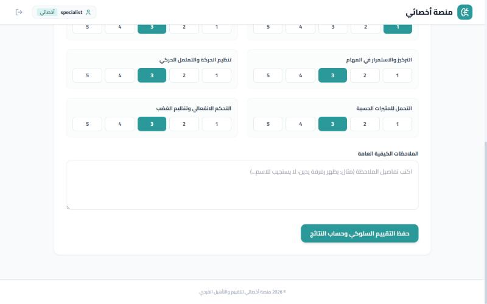
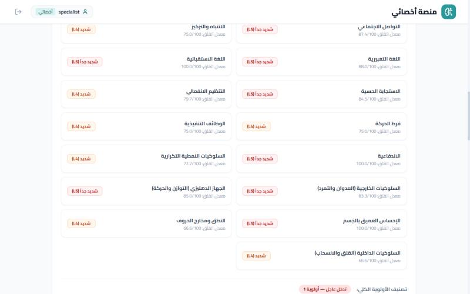
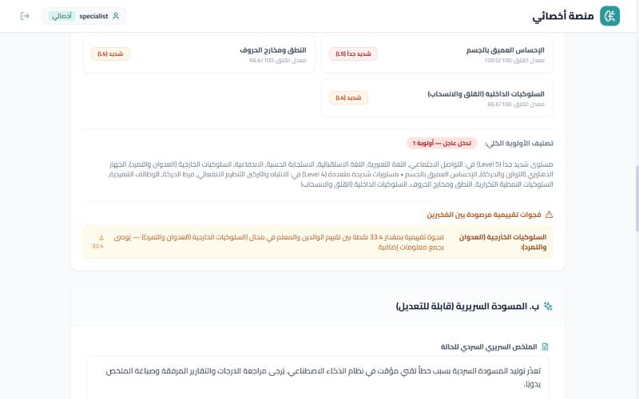

# Specialist / admin flow

The clinician records an observation and reviews the rule-engine results and report draft.

_Fictional test data, local run._

### Specialist dashboard: case awaiting clinical observation

### Clinical observation form (1-5 scales)

### Observation notes and submit

### Severity level and anxiety index per domain (deterministic rule engine)

### Overall priority tier and parent/teacher discrepancy flags

> The AI-written narrative section needs an `OPENROUTER_API_KEY`; it was not configured for these screenshots, so only the deterministic scoring and flags are shown.
