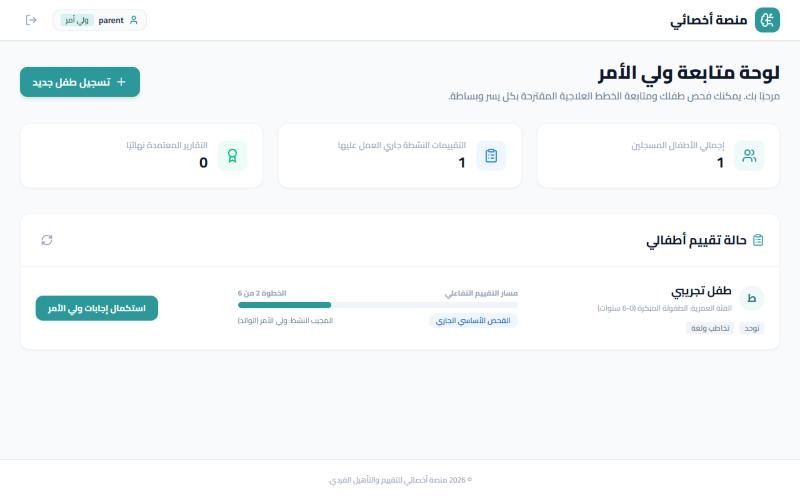
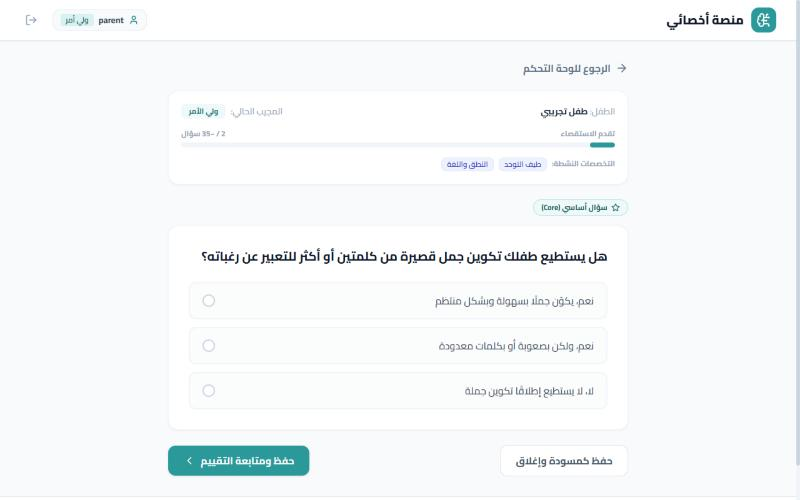

# Parent flow

The parent registers a child, then answers the adaptive questionnaire.

_Fictional test data, local run._

### Parent dashboard: register a new child

### Registration form (fictional test data) with the screening specialties selected

### Case created; progress tracker (step 2 of 6)

### Single-choice question (Arabic, RTL)

### 1-5 rating scale question

### Answer selected before saving and continuing

### Adaptive follow-up question (speech and language)

### After finishing: waiting for the teacher

