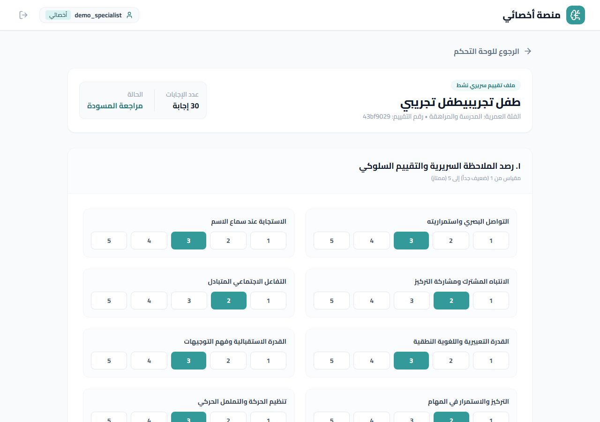
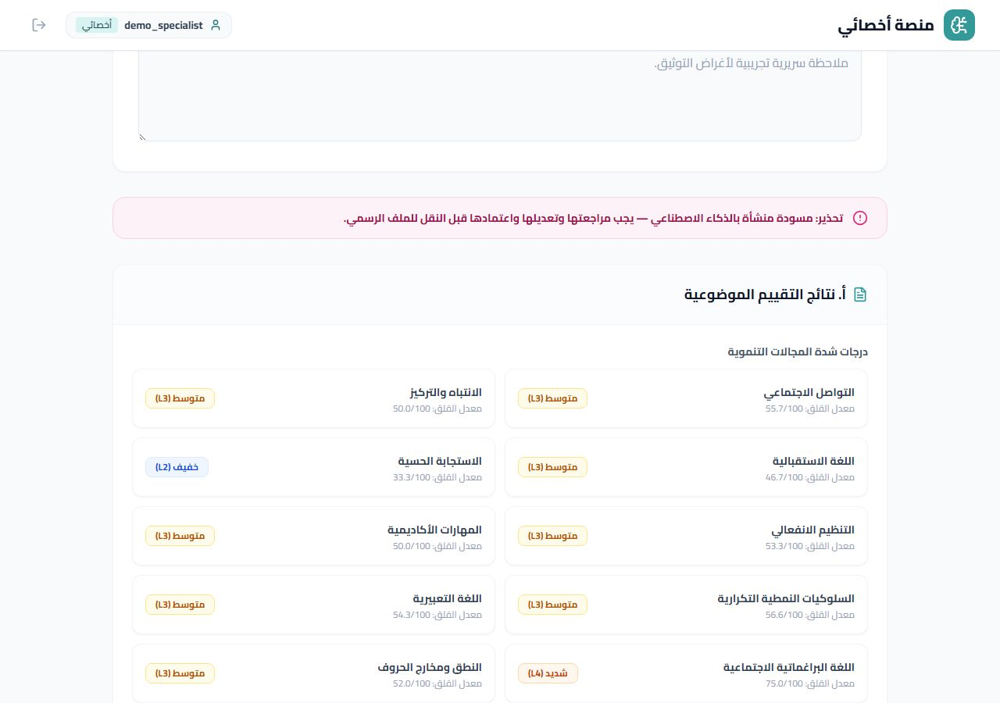
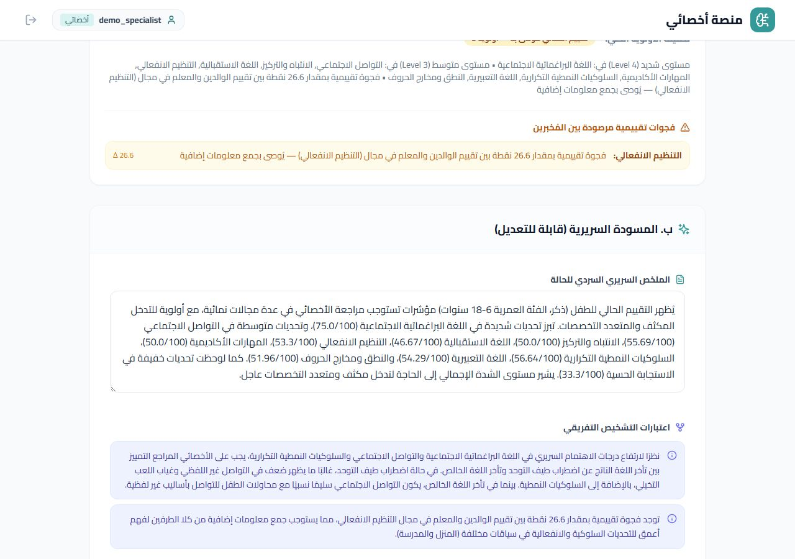
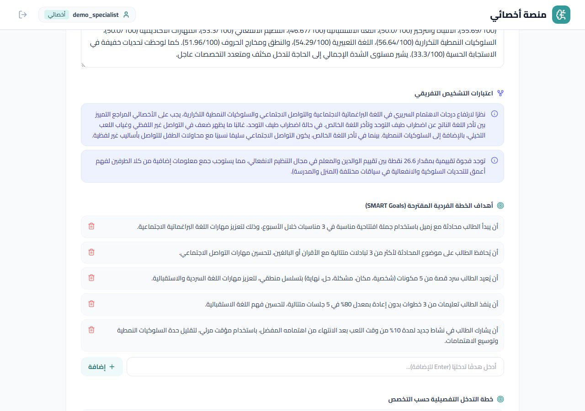
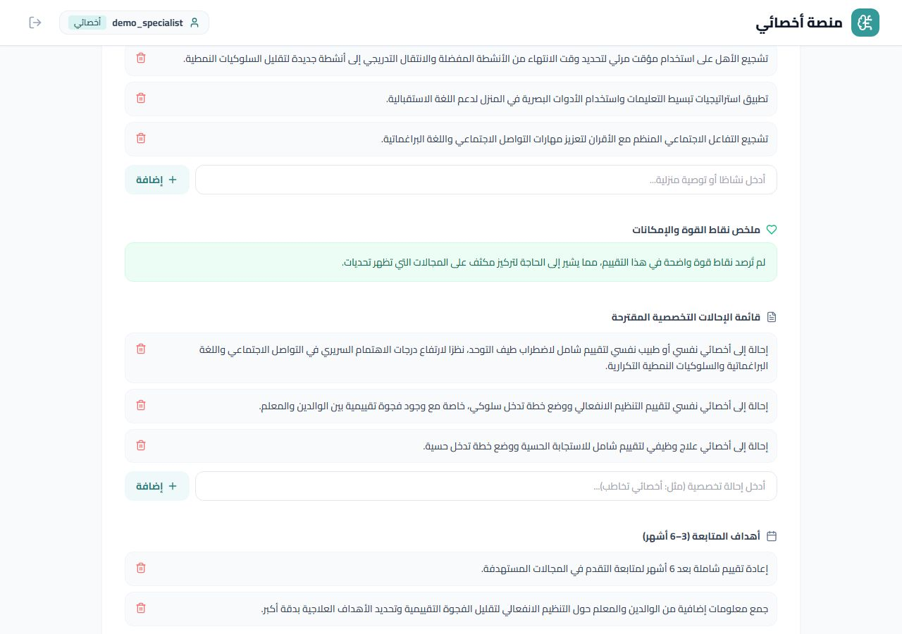

# Final report results

What the specialist sees after a full parent → teacher → specialist cycle and
`POST /sessions/{id}/generate-report` runs: the deterministic severity scores
plus the AI-drafted clinical report, all on one editable page before approval.

Captured from a real run against the live deployment (synthetic "طفل تجريبي"
test case, autism specialty) — not a mockup.

### Clinical observation review

### Domain severity scores (deterministic rule engine)

### AI-drafted report — narrative summary & differential considerations

### AI-drafted report — SMART goals

### AI-drafted report — specialty referrals

> The full draft also includes an intervention plan by specialty, school
> accommodations, a home program, a strengths summary, follow-up goals, and
> technical/clinical caveats — all editable inline by the specialist before
> approval. See [`pages/ClinicianPortal.tsx`](../../../frontend/src/pages/ClinicianPortal.tsx).
