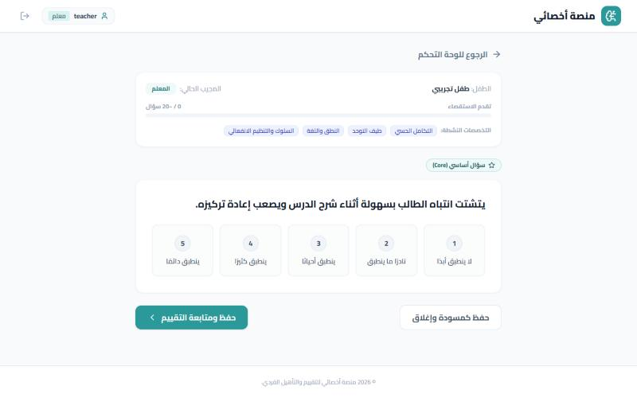

# Teacher flow

The teacher answers the school-environment questionnaire for the same case.

_Fictional test data, local run._

### Teacher questionnaire (school-environment items)

### Social interaction question

### Teacher dashboard: the case moves on to the clinician

