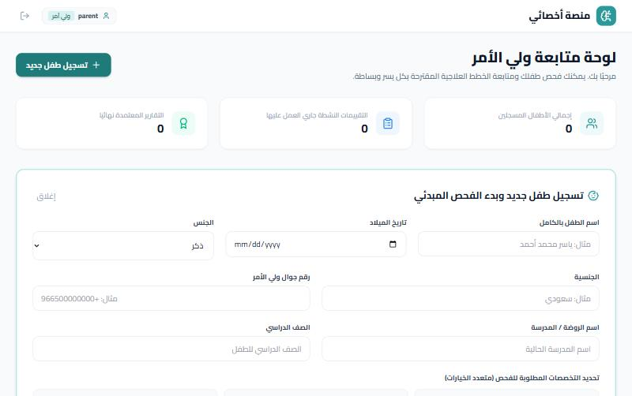
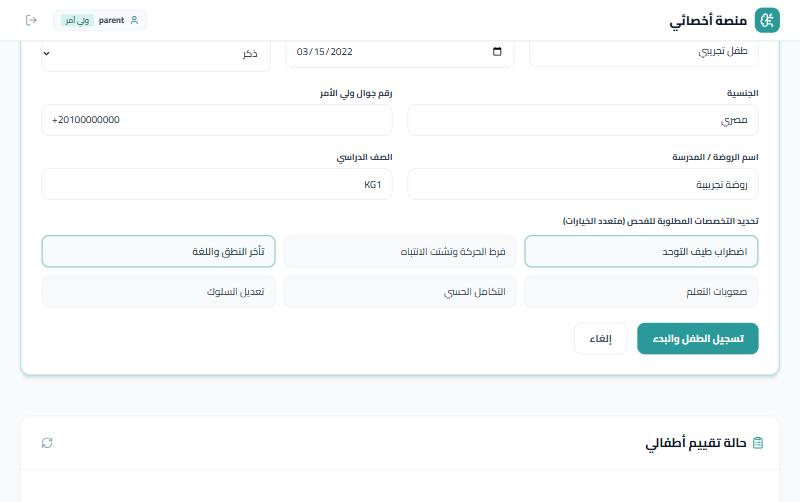
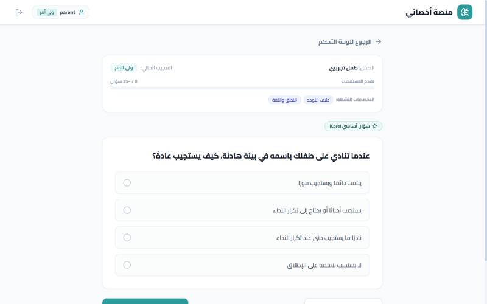
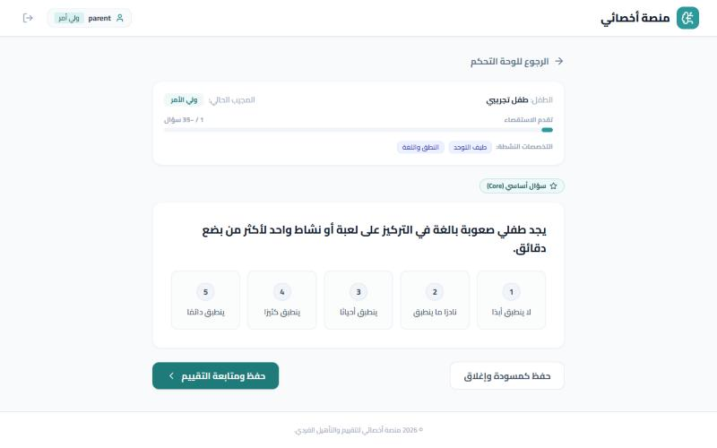
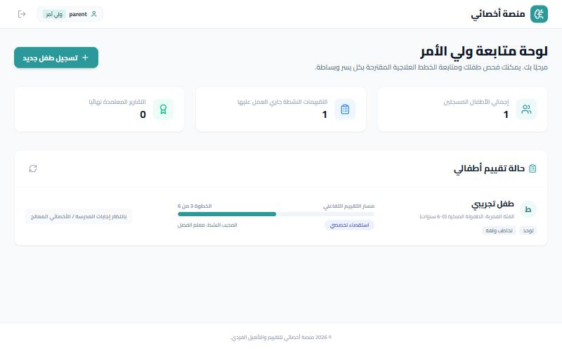
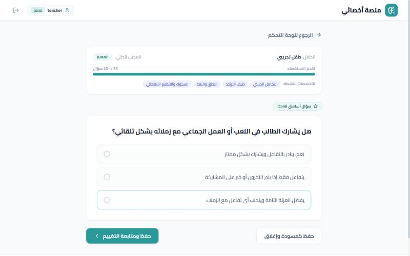
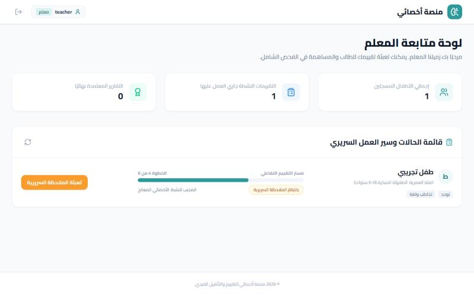
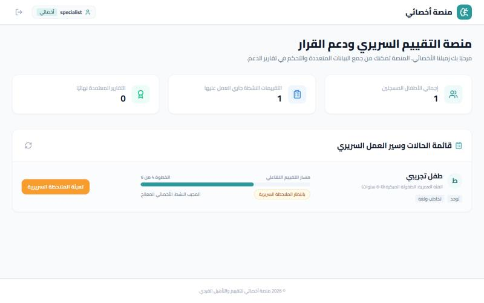
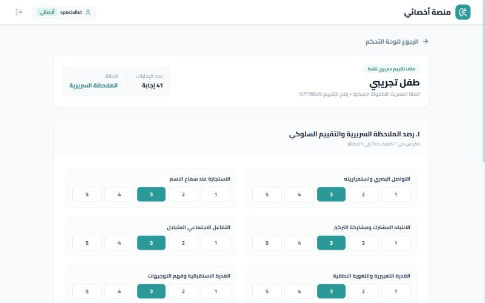

# Project 1 - Akhessai assessment walkthrough

Screenshots of one complete case, captured from a **local run with fictional test data**: parent questionnaire, teacher questionnaire, clinician observation and the rule-engine results.

### Parent dashboard: register a new child

### Registration form (fictional test data) with the screening specialties selected

### Case created; the parent's progress tracker (step 2 of 6)

### Parent questionnaire: single-choice question (Arabic, RTL)

### Parent questionnaire: 1-5 rating scale

### Answer selected before saving and continuing

### Adaptive follow-up question (speech and language)

### Parent view after finishing: waiting for the teacher

### Teacher questionnaire (school-environment items)

### Teacher questionnaire: social interaction question

### Teacher dashboard: case moves on to the clinician

### Specialist dashboard: case awaiting clinical observation

### Clinical observation form (1-5 scales)

### Observation notes and submit

### Results: severity level and anxiety index per domain from the deterministic rule engine

### Results: overall priority tier and parent/teacher discrepancy flags

> The AI-written narrative section of the report needs an `OPENROUTER_API_KEY`; it was not configured for these screenshots, so only the deterministic scoring and flags are shown.
